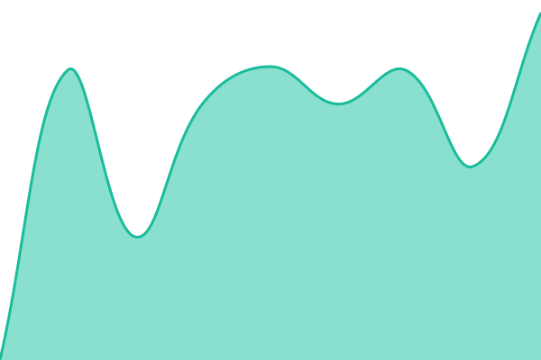
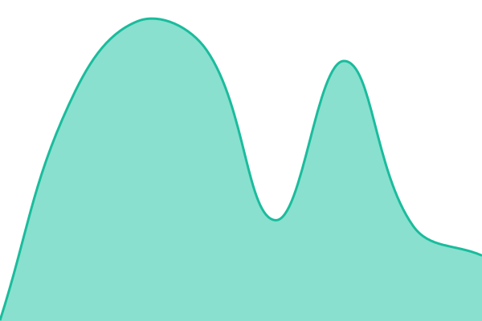
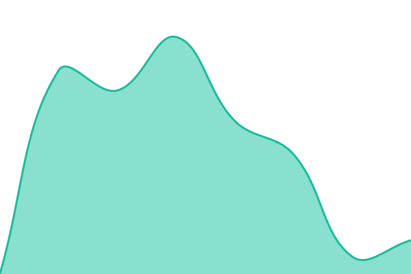
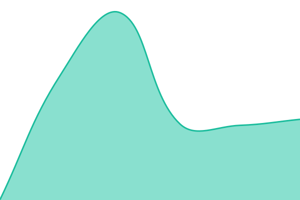

# [📈 Live Status](https://status.ripplefx.app): <!--live status--> **🟩 All systems operational**

This repository contains the open-source uptime monitor and status page for [ConnectingTheDots](https://status.ripplefx.app), powered by [Upptime](https://github.com/upptime/upptime).

With [Upptime](https://upptime.js.org), you can get your own unlimited and free uptime monitor and status page, powered entirely by a GitHub repository. We use [Issues](https://github.com/ConnectingTheDots-DCWK/status/issues) as incident reports, [Actions](https://github.com/ConnectingTheDots-DCWK/status/actions) as uptime monitors, and [Pages](https://status.ripplefx.app) for the status page.

<!--start: status pages-->
<!-- This summary is generated by Upptime (https://github.com/upptime/upptime) -->
<!-- Do not edit this manually, your changes will be overwritten -->
<!-- prettier-ignore -->
| URL | Status | History | Response Time | Uptime |
| --- | ------ | ------- | ------------- | ------ |
|  [Website](https://get.ripplefx.app/) | 🟩 Up | [website.yml](https://github.com/ConnectingTheDots-DCWK/status/commits/HEAD/history/website.yml) | 

 649ms
     
 | 

<a href="https://status.ripplefx.app/history/website">100.00%</a>
    

|  [Updates and downloads](https://get.ripplefx.app/api/releases) | 🟩 Up | [updates-and-downloads.yml](https://github.com/ConnectingTheDots-DCWK/status/commits/HEAD/history/updates-and-downloads.yml) | 

 939ms
     
 | 

<a href="https://status.ripplefx.app/history/updates-and-downloads">100.00%</a>
    

|  [Engine patches](https://get.ripplefx.app/api/engine?contract=1.6&target=x86_64-unknown-linux-gnu&variant=python&bridge=-897256118&current=1.6.0) | 🟩 Up | [engine-patches.yml](https://github.com/ConnectingTheDots-DCWK/status/commits/HEAD/history/engine-patches.yml) | 

 805ms
     
 | 

<a href="https://status.ripplefx.app/history/engine-patches">100.00%</a>
    

|  [News](https://get.ripplefx.app/news/feed.xml) | 🟩 Up | [news.yml](https://github.com/ConnectingTheDots-DCWK/status/commits/HEAD/history/news.yml) | 

 385ms
     
 | 

<a href="https://status.ripplefx.app/history/news">100.00%</a>
    

|  [Documentation](https://docs.ripplefx.app/) | 🟩 Up | [documentation.yml](https://github.com/ConnectingTheDots-DCWK/status/commits/HEAD/history/documentation.yml) | 

 276ms
     
 | 

<a href="https://status.ripplefx.app/history/documentation">100.00%</a>
    

|  [Legal documents](https://legal.ripplefx.app/v/eula-3.0) | 🟩 Up | [legal-documents.yml](https://github.com/ConnectingTheDots-DCWK/status/commits/HEAD/history/legal-documents.yml) | 

 299ms
     
 | 

<a href="https://status.ripplefx.app/history/legal-documents">100.00%</a>
    

|  [Demo](https://demo.ripplefx.app/) | 🟩 Up | [demo.yml](https://github.com/ConnectingTheDots-DCWK/status/commits/HEAD/history/demo.yml) | 

 375ms
     
 | 

<a href="https://status.ripplefx.app/history/demo">100.00%</a>
    

|  [Crash reports](https://zrnamamcqiiwckdezsmj.supabase.co/storage/v1/status) | 🟩 Up | [crash-reports.yml](https://github.com/ConnectingTheDots-DCWK/status/commits/HEAD/history/crash-reports.yml) | 

 700ms
     
 | 

<a href="https://status.ripplefx.app/history/crash-reports">100.00%</a>
    

|  [Usage statistics](https://zrnamamcqiiwckdezsmj.supabase.co/auth/v1/health) | 🟩 Up | [usage-statistics.yml](https://github.com/ConnectingTheDots-DCWK/status/commits/HEAD/history/usage-statistics.yml) | 

 577ms
     
 | 

<a href="https://status.ripplefx.app/history/usage-statistics">100.00%</a>
    

|  [Dictation models](https://huggingface.co/altunenes/parakeet-rs/resolve/4d2a8bc71f5c896ec40faa59732e6716295edaf2/nemotron-speech-streaming-en-0.6b/encoder.onnx) | 🟩 Up | [dictation-models.yml](https://github.com/ConnectingTheDots-DCWK/status/commits/HEAD/history/dictation-models.yml) | 

 373ms
     
 | 

<a href="https://status.ripplefx.app/history/dictation-models">100.00%</a>
    

<!--end: status pages-->

[**Visit our status website →**](https://status.ripplefx.app)

## 📄 License

- Powered by: [Upptime](https://github.com/upptime/upptime)
- Code: [MIT](./LICENSE) © [Anand Chowdhary](https://anandchowdhary.com)
- Data in the `./history` directory: [Open Database License](https://opendatacommons.org/licenses/odbl/1-0/)
